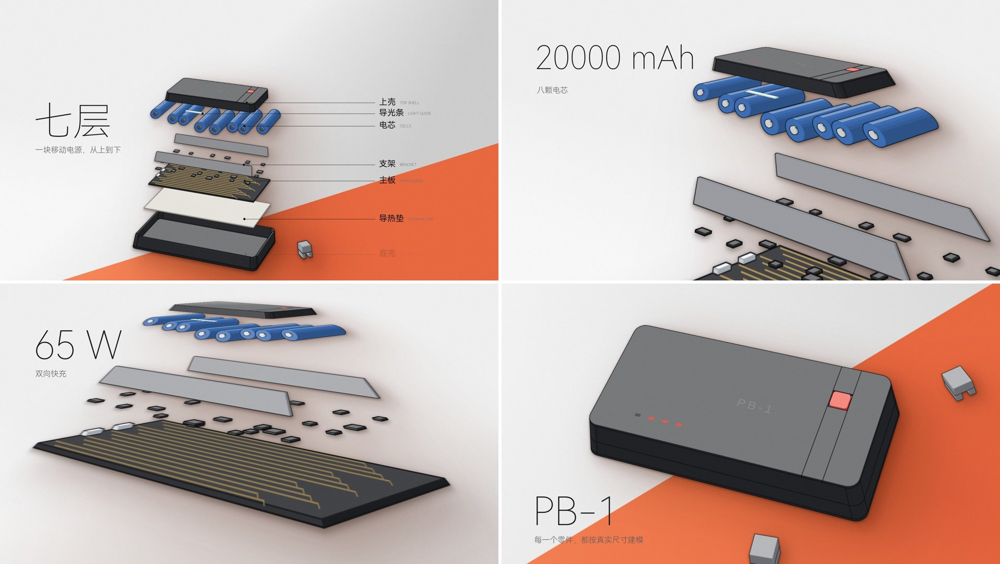
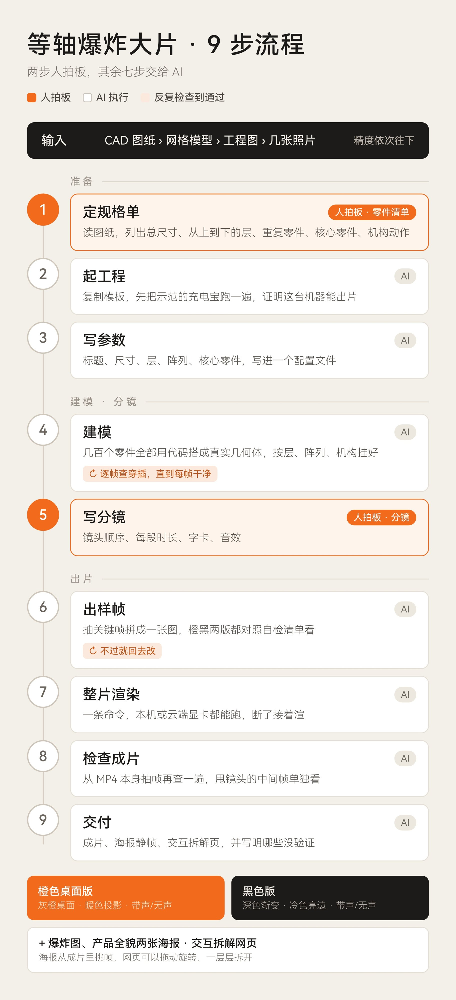

# 等轴爆炸大片 · Isometric Exploded-View Film

**中文** · [English](#english)



一个给 AI 用的 Skill：把任何实体产品做成 30 秒的等轴测拆装广告片。固定机位，几百个零件分层炸开，带参数字卡和卡点配乐，同一套动画出橙色、黑色两版。

输入可以是 CAD（STEP/IGES）、网格模型（STL/OBJ/GLB 等）、工程图，或者几张照片，精度依次往下。

## 原理

先把产品拆成几百个真实的几何零件，再按分镜让这些零件一帧一帧动起来，最后由程序把每一帧合成成片。AI 写的是零件和镜头，画面是算出来的，所以每一帧都稳，改哪里都能精确改。

## 硬规则

- **几何即一切**：画面里只有代码搭的零件，不贴图，不用照片，印刷字也画在零件表面。
- **真实尺寸**：零件数、层级、开合方式都照真实产品来。
- **零件不许穿插**：每一帧都要过检查，穿了就挪零件或拆零件，不放宽标准。
- **一镜到底**：换镜头用约 0.25 秒的甩镜，停留时镜头缓慢漂移，只有最后半秒静止。
- **风格固定**：机位、两套配色、字体、字卡位置都写在 Skill 里。
- **授权**：用别人的 CAD 时，不分发由它导出的模型数据，片尾不放对方 logo，只打型号。

## 流程（9 步，两步人拍板）



1. 定规格单（**人拍板：零件清单**）
2. 起工程，先跑通示范的充电宝
3. 写参数
4. 建模，逐帧查穿插直到干净
5. 写分镜（**人拍板：分镜**）
6. 出样帧，对照自检清单
7. 整片渲染（本机 CPU、云端或 AutoDL 等显卡服务器）
8. 检查成片
9. 交付：两版成片（带声/无声）、海报静帧、交互拆解网页

## 安装

把整个文件夹放进你的 Agent 的 skills 目录，例如 Claude Code：

```bash
git clone https://github.com/Warrickchenxin/iso-explode-film ~/.claude/skills/iso-explode-film
```

然后对 AI 说：「用等轴爆炸大片 Skill，把这份 CAD 做成一条 30 秒的拆装广告片」。

需要 Node 18+、Python 3.10+、ffmpeg 和 Chrome/Chromium。第 2 步会自动装依赖、下载字体并自检。

## 目录

- `SKILL.md`：Skill 入口
- `references/`：建模、分镜、动画、配色、字卡与声音、渲染、自检清单，以及键盘案例
- `scripts/`：起工程、CAD/网格清单、加材质
- `template/`：完整可运行的示范工程（一块 7 层、84 个零件的充电宝）

## 致谢

等轴测绘制部分基于 [Anatomy](https://github.com/wheresryan22) 工具包（MIT）。思路受 [anatomy-reveal-skill](https://github.com/annnguyentt/anatomy-reveal-skill) 启发。

## 许可

MIT，第三方部分见 `THIRD_PARTY_NOTICES.md`。

---

<a id="english"></a>

# Isometric Exploded-View Film (等轴爆炸大片)

[中文](#等轴爆炸大片--isometric-exploded-view-film) · **English**

A skill for AI agents that turns any physical product into a 30-second isometric teardown-and-assembly ad film: a fixed camera, hundreds of parts exploding layer by layer, spec cards and a beat-synced score, rendered in two looks (orange desk and black) from the same animation.

Input can be CAD (STEP/IGES), a mesh (STL/OBJ/GLB and others), drawings, or a few photos, with accuracy going down in that order.

## How it works

The product is rebuilt as hundreds of real geometric parts. A storyboard drives those parts frame by frame, and a compositor renders every frame into the film. The AI writes parts and shots; the pictures are computed, so every frame is stable and any detail can be changed precisely.

## Hard rules

- **Geometry only**: everything on screen is a part built in code. No textures, no photos; printing is drawn on part faces.
- **Real dimensions**: part counts, layers and the way it opens follow the real product.
- **No intersecting parts**: every frame is checked; fix it by moving or splitting parts, never by loosening the check.
- **One continuous take**: cuts are ~0.25 s whip pans, holds keep drifting, only the last half second is still.
- **Fixed style**: camera, the two palettes, fonts and card positions are defined in the skill.
- **Licensing**: with someone else's CAD, do not redistribute geometry derived from it, and show the model name only, no logo.

## Workflow (9 steps, 2 need a human)

1. Spec sheet (**human approves the parts list**)
2. Scaffold the project and run the power-bank example
3. Write the parameters
4. Model, scanning every frame until no parts intersect
5. Storyboard (**human approves the storyboard**)
6. Sample frames, checked against the QA list
7. Full render (laptop CPU, cloud workspace, or a GPU server such as AutoDL)
8. Check the finished MP4
9. Deliver: both films with and without sound, poster stills, an interactive teardown page

## Install

Put the folder in your agent's skills directory, for example Claude Code:

```bash
git clone https://github.com/Warrickchenxin/iso-explode-film ~/.claude/skills/iso-explode-film
```

Then ask: "Use the iso-explode-film skill to make a 30-second teardown ad film from this CAD."

Requires Node 18+, Python 3.10+, ffmpeg and Chrome/Chromium. Step 2 installs dependencies, downloads fonts and runs a self-check.

Note: `SKILL.md` and the references are written in Chinese; current models follow them fine in either language.

## Credits

Isometric drawing is built on the [Anatomy](https://github.com/wheresryan22) kit (MIT). Inspired by [anatomy-reveal-skill](https://github.com/annnguyentt/anatomy-reveal-skill).

## License

MIT. Third-party parts: see `THIRD_PARTY_NOTICES.md`.
